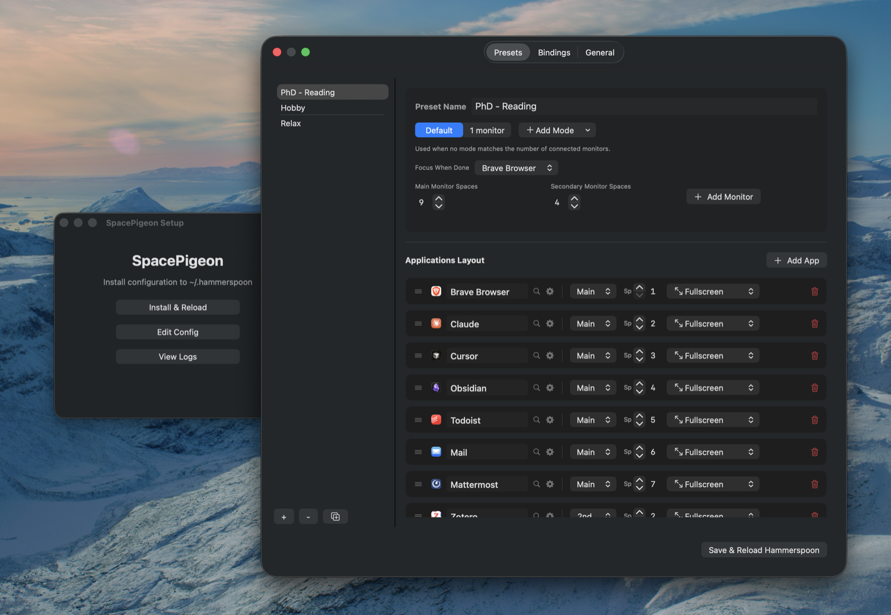

# SpacePigeon: Saved Workspaces for macOS

<div align="center">
  
</div>

**SpacePigeon** is a native macOS app (powered by Hammerspoon) that lets you define *workspaces* — which apps open, which desktop spaces they go to, and how windows are arranged.

Effortlessly transition between workflows. SpacePigeon instantly orchestrates your applications, windows, and displays into the perfect environment for any task with a single click or hotkey.

## What's new in 2.0

- **No more quitting**: apps that are already open are moved to their space instead of being closed and reopened, using the new `spacectl` helper (macOS 26.4+, SIP stays on).
- **Native fullscreen**: put fullscreen apps exactly where you want them in the Mission Control bar.
- **More positions**: halves, thirds, two-thirds, quarters and center.
- **Up to 10 monitors**, **modes per monitor count**, an optional rearrange when a monitor is plugged in or out, and **Focus When Done**.
- **Save before quitting**, a **menu bar** preset picker, and a **log viewer** for every run.
- **App picker** with your installed apps, and **drag and drop** to reorder apps.

See [CHANGELOG.md](CHANGELOG.md) for the full list. Configs from 1.x keep working.

## Features

- 🚀 **One-Click Setup**: Installs everything automatically. If you don't have Hammerspoon, SpacePigeon will download and install it for you.
- 🎨 **Visual Configuration**: A full native UI to manage your workspaces. No need to touch Lua code manually.
- 🖥 **Multi-Monitor Support**: Configure spaces and app layouts for up to 10 monitors.
- ⚡️ **Smart App Launching**:
  - **Browser Mode**: Launch browsers with specific startup URLs.
  - **Deep Links**: Open apps to specific content (e.g., Notion pages, Spotify playlists, or custom URL schemes).
- 🪟 **Window Management**: Automatically position windows:
  - Maximize
  - Halves (left, right, top, bottom), thirds, two-thirds, quarters, or centered
  - A custom part of the screen
  - Native fullscreen, in the order you choose
  - Several windows of one app, like two Terminal windows side by side
- 📸 **Save the current layout**: Turn the windows you have open right now into a new preset.
- ♻️ **No more quitting**: Apps that are already open are moved to their space instead of being closed and reopened.
- ⌨️ **Hotkeys**: Bind global hotkeys to trigger specific presets instantly.
- 🐦 **Menu Bar**: Pick a preset from the menu bar.
- 🔌 **Follows your monitors**: Optionally rearranges your windows when you plug in or unplug a monitor.
- 💾 **Save before quitting**: Presses Cmd+S in the apps you choose before quitting them.
- 📑 **Presets**: Create multiple workspace states (e.g., "Work", "Chill", "Stream") and switch between them.

## Installation

### Option 1: Download App (Recommended)
1. Go to the **[Releases](../../releases)** page.
2. Download `SpacePigeon.zip`.
3. Unzip the file.
4. Run **SpacePigeon.app**.
5. Click **"Install & Reload"**.

### "Unidentified Developer" Warning?
If macOS prevents the app from opening because it "cannot be verified":

1. Click **Done** (or Cancel) on the warning dialog.
2. Open **System Settings**.
3. Go to **Privacy & Security**.
4. Scroll down to the **Security** section.
5. Click the **Open Anyway** button next to *"SpacePigeon.app was blocked..."*.
6. Click **Open** in the final confirmation.

*(This is required because the app is open-source and not signed with a paid Apple Developer certificate).*

### Option 2: Build from Source
If you prefer to build it yourself:

1. Clone the repository:
   ```bash
   git clone https://github.com/louivers/spacepigeon.git
   cd spacepigeon
   ```
2. Run the build script:
   ```bash
   ./scripts/build_app.sh
   ```
3. Open the generated app:
   ```bash
   open SpacePigeon.app
   ```

## Configuration

Launch SpacePigeon and click **"Edit Config"** to open the configuration editor.

### Presets Tab
Manage your workspace layouts here.
- **Spaces**: How many spaces you want on each monitor (**Add Monitor** adds a third and more, up to 10; monitors are numbered from the main one, then left to right), counting desktops and fullscreen apps together (what you see in the Mission Control bar). Every space without a fullscreen app is a desktop. If something clashes (two fullscreen apps on one number, an app past the last space), a warning shows under the counts.
- **Modes**: Give a preset a different layout for a given number of connected monitors with **Add Mode**. When you trigger the preset, SpacePigeon uses the mode for the number of monitors connected right now, or the **Default** layout if there is none. A new mode starts as a copy of the default; the spaces of monitors past the mode's count go after the main monitor's. SpacePigeon does the same when a monitor in the layout is not connected.
- **Focus When Done**: The app that has focus when the setup is complete. SpacePigeon switches to the space with that app's window. **First app** (the default) focuses the first app on the main monitor's first space.
- **Applications Layout**: Add apps to the list. Drag a row by its handle (☰) to reorder. Each row is one window: add an app twice to place two of its windows (see [Several windows of one app](#several-windows-of-one-app)).
  - **Name**: The application name (e.g., "Safari", "Terminal"). Click the magnifying glass to pick from your installed apps.
  - **Monitor**: Choose "Main", "2nd", "3rd" and so on.
  - **Space**: Where the app goes in Mission Control, counting desktops and fullscreen apps together from the left. Example with 5 spaces: Brave fullscreen at 1 and Cursor at 3 gives *Brave, Desktop, Desktop with Cursor, Desktop, Desktop*.
  - **Position**: Maximize, Fullscreen, a half (left, right, top, bottom), a third or two-thirds, a quarter, Center, or Custom. A fullscreen app takes its space for itself. Custom opens the gear settings, where you set the part of the screen in percent.
  - **Gear Icon ⚙️**: Access advanced settings:
    - **Is this a Browser?**: Check this to enable startup URL support.
    - **URL**: Enter a web URL (for browsers) or a deep link (for other apps) to open on launch.
    - **Custom Position**: Left, top, width and height in percent of the screen (only for the Custom position).
    - **Window**: Text from the title of the window this row should get, and how to open a new window. See below.
- **New preset from the current layout** (📷 button under the preset list): reads the windows that are open right now and adds them as a new preset: each window's app, monitor, space and position. Positions close to a half, third, quarter or the whole screen snap to it; anything else becomes a Custom position. Check the new preset, give it a name, then save. The SpacePigeon and Hammerspoon windows are left out. You can do the same with **Save Current Layout as Preset…** in the menu bar.

### Several windows of one app
Each row in a preset is one window. Add an app more than once to place several of its windows, for example two Terminal windows on the left and right half of a desktop.

- Rows get the app's windows in list order. A window keeps its row when you set the preset up again, so windows are not swapped around.
- If the app has fewer windows open than it has rows, SpacePigeon opens more with **Cmd+N**. For apps that open a window another way, set **Open a new window with** in the gear settings: **A menu item** (the menu, then the item, like `Shell > New Window`) or **AppleScript** (like `tell application "iTerm" to create window with default profile`). If no window shows up, the row is skipped with a warning in the log.
- To give a row a specific window, enter text from its **title** under **Window**. Example: two Chrome profiles. Name each window with *Window > Name Window…* in Chrome ("Work", "Personal"), enter that name under **Window**, and set **Open a new window with** to the menu item `Profiles > Work`, so the right profile opens when that window is missing.
- Titles of windows on other desktops can only be read from their desktop, so SpacePigeon briefly visits those desktops when a row has window text.

### Bindings Tab
Set up global hotkeys to trigger your presets.
- **Modifiers**: `cmd`, `alt`, `ctrl`, `shift` (comma separated).
- **Key**: The key to press (e.g., `S`, `1`, `F`).
- **Preset**: Select which preset this hotkey should activate.

### General Tab
Global settings that apply to all presets.
- **Quit apps that are not in the preset**: On by default. Apps that *are* in the preset are never quit; their windows are moved.
- **Rearrange when a monitor is plugged in or unplugged**: Off by default. When the number of monitors changes, the last preset is set up again, using its mode for the new count if it has one. No apps are quit; windows are only moved.
- **Show presets in the menu bar**: On by default. The menu also has **Save Current Layout as Preset…**.
- **Keep Alive Apps**: A list of applications that should *not* be quit when switching presets.
  - By default, SpacePigeon quits apps not defined in the current preset to keep your workspace clean.
  - Add apps here (e.g., "Spotify", "Discord") to keep them running in the background.
  - If a kept-alive app is also part of the new preset's layout, it will be moved to its assigned space/position.
- **Save Before Quitting**: Apps that get Cmd+S in each of their windows before SpacePigeon quits them, i.e. when a preset without them is set up (e.g. "TextEdit", "Pages").
  - Documents that were never saved are left alone: the app asks about them when it quits.
  - Don't add browsers or other apps where Cmd+S does something else.
  - SpacePigeon never force quits an app that is asking about unsaved changes. It stops and asks you to save or close your work first.

After making changes, click **"Save & Reload Hammerspoon"** to apply them immediately.

## How windows are moved

SpacePigeon ships a small helper, `spacectl` (source in `helper/`, installed to `~/.hammerspoon/bin/spacectl`). It uses a private macOS call to move windows between spaces and a fast swipe trick to switch spaces without opening Mission Control. Both work with System Integrity Protection (SIP) turned on, on **macOS 26.4 and newer**.

If the helper is missing or a move does not work, SpacePigeon falls back to the old way: switching spaces through Mission Control, and quitting and reopening an app on the right space as a last resort.

Spaces cannot be moved by any API. macOS puts a new desktop after the last desktop and a new fullscreen app at the very end. So SpacePigeon first gets the right number of desktops, makes the fullscreen apps fullscreen (they land at the end), and then drags each one to its place in the Mission Control Spaces bar. It reads the exact thumbnail positions from Mission Control, so the drags are precise; the mouse moves for a moment and is put back afterwards. You can turn the dragging off in the General tab; fullscreen apps then stay after the last desktop, in order. When everything is already in place, nothing happens.

**Tip:** turn off *System Settings > Desktop & Dock > Automatically rearrange Spaces based on most recent use*, or macOS will shuffle your spaces again.

### Check that it works on your Mac
```bash
bash scripts/build_helper.sh         # builds build/spacectl
./build/spacectl check               # "move": true means window moves work
./build/spacectl selftest            # moves your Terminal window to another desktop and back
```
`selftest` needs at least two desktops on the screen you run it from.

### Logs
Every workspace run is logged to `~/.hammerspoon/spacepigeon.log`: each step with how long it took, which apps were quit, which windows were moved or relaunched, and every warning and error. Open **View Logs** in the SpacePigeon app (or run `open -a SpacePigeon --args --logs`) to browse runs, filter warnings and errors, and copy a run as text.

### Tests without a Mac
The space arranging and the workspace flow have simulation tests that run with plain Lua 5.4 (`brew install lua`):
```bash
lua tests/slots_sim.lua
lua tests/structure_sim.lua
lua tests/mcdrag_sim.lua
lua tests/workspace_sim.lua
lua tests/dragbench_sim.lua
lua tests/profile_sim.lua
lua tests/windows_sim.lua
```
GitHub Actions runs them on every push and pull request.

### Trying changes without touching your own presets
`scripts/profile.sh demo` opens the app on a separate **profile** with sample presets, for screenshots and recordings. `scripts/profile.sh off` goes back to your own setup. See [docs/testing.md](docs/testing.md), which also covers testing a release as a new user would.

## Requirements
- **macOS 12 (Monterey) or newer**, on an Intel or Apple Silicon Mac.
- **[Hammerspoon](https://www.hammerspoon.org/)** (The app will automatically download and install this to `~/Applications` if it is not found).
- **macOS 26.4 or newer** for the `spacectl` helper, which moves windows between spaces without quitting apps. On older versions SpacePigeon uses the fallback (Mission Control, and quitting and reopening an app as a last resort).
- **Xcode Command Line Tools** to build from source (`xcode-select --install`).

## License
MIT
